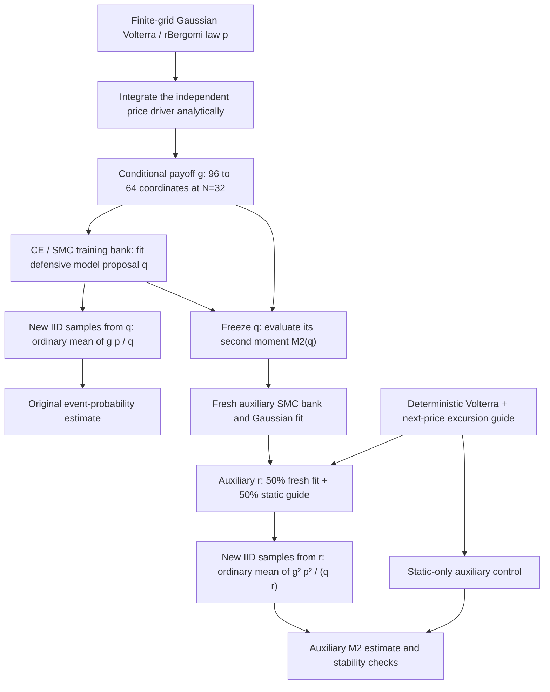
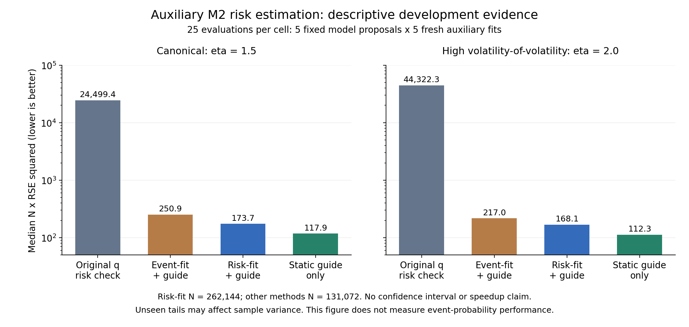

# Exact Conditional Residual Path-Space Transport for Gaussian Volterra Rare Events

[](https://github.com/YoungJun0814/Neural_Path_Intergral/actions/workflows/ci.yml)
[](https://www.python.org/)
[](#research-status)

> Exact finite-grid rare-event estimation and tail-risk diagnostics for rough
> Bergomi / Gaussian Volterra models. The current work separates the event
> estimator from an independently sampled auxiliary second-moment estimator.

## Research status

**Current status (2026-10-28): a guide-free Gaussian-split HMC reference and tail-aware continuum bounds were implemented and evaluated. All 32 pilot wholes completed in a same-seed operational replay after preserving the original timeout. HMC missed the required 1.5% reference RSE and was not adopted. Sharper Jensen constants reduced the continuum bounds but they remain vacuous. P1/P2 remain unresolved; no production or large-training authorization; not submission-ready.**

### Latest result at a glance

A **Gaussian-split Hamiltonian MH** reference uses fresh momentum and the full
Hamiltonian correction, without the learned dictionary or bank. A gradient
four-move control used the same number of probability/gradient callbacks.

| N4096 cell | Gradient-control RSE | Gaussian-split HMC RSE | Required |
|---|---:|---:|---:|
| Canonical | 8.88% | 24.76% | ≤1.5% |
| High eta | 5.15% | 20.95% | ≤1.5% |

HMC moved farther in ambient coordinates but did not improve independent-whole
normalizer precision. Its prespecified fresh-precision allocation exceeded the
128-whole-per-cell cap, so no extra precision samples were generated and no
equivalence test was evaluated. This fixed candidate is **not adopted**.

The first execution timed out after 20 pilot wholes; that failure is preserved.
A separate same-seed full-family replay completed all 32 wholes and matched all
24 originally completed pilot/preflight records, excluding wall time. The
repeated records are not counted as additional independent samples.

For continuum error, a probability-root inequality and exact time-average
Gaussian variance in Jensen bounds were derived and implemented. N4096 absolute
upper bounds fell from about **68.83 to 8.125** (canonical) and **5207.37 to
118.116** (high eta), but still clip to the uninformative probability range 1.
These are bounds, not measured biases. A structural floor identifies why more
global-envelope/Holder constant tuning alone cannot close the current gap;
it is not an impossibility theorem for the model or other proof methods.

See the [execution plan](docs/plans/P2_HAMILTONIAN_AND_TAIL_BOUND_2026-10-28_KO.md),
[operational replay contract](docs/plans/P2_HAMILTONIAN_OPERATIONAL_REPLAY_2026-10-28_KO.md)
and [results, mathematical review and stop decisions](docs/reviews/P2_HAMILTONIAN_AND_TAIL_BOUND_RESULT_2026-10-28_KO.md).
Neither remaining P2 obligation is claimed solved.

Local verification passed **1,991 tests** (85% source statement coverage),
CI-scope Ruff, Mypy on 230 source/main files and separate checks on all three
new runners. Representative replay and eight frozen-archive checks passed.
The test run retained one restricted-cache-write warning; the shared Python
environment's pre-existing dependency conflicts were not modified or hidden.
See the [verification receipt and preserved logs](results/post_audit/p2_hamiltonian_operational_replay_v1/session_20261028/verification_receipt.json).
These checks do not certify statistical accuracy, continuum bias or remote CI.

### Preceding direct paired-grid P2 study

A guide-free **gradient + cyclic Gaussian-pair MH** arm was compared with a
gradient-only control on the original paired N4096/N2048 Gaussian law. The
cyclic proposal preserves the Gaussian prior, not the physical Volterra target;
its MH correction re-evaluates the target. Full SMC normalizers were retained.

| N4096 cell | Gradient-control RSE | Gradient-cyclic RSE | Required |
|---|---:|---:|---:|
| Canonical | 7.32% | 32.16% | ≤1.5% |
| High eta | 16.50% | 18.25% | ≤1.5% |

All four cases failed reference precision and maximum-whole concentration
checks. Equivalence with the existing approximately 0.9%-RSE frozen-ensemble
IID reference was therefore **not evaluated**. The new cyclic arm is not
adopted or expanded. Eight wholes per case do not establish a universal
population efficiency ordering.

Covariance-aware signed adjacent differences passed the fixed 10% development
gate in all four cases. These small paired differences are **not** a continuum
certificate and cannot independently validate two inaccurate grid estimates.
The current conservative continuum absolute upper bound clips to 1 in both
cells even at N16384, so it gives no useful relative-bias certification. This
does not prove that the actual bias is large.

The run used 1,027,712 physical forwards; four whole replays used another
128,000. All source/seed/work bindings, stored-whole checks, representative
replays and decision recomputations passed. See the
[frozen P2 execution plan](docs/plans/P2_DIRECT_CLOSURE_EXECUTION_2026-10-27_KO.md),
[theory review](docs/theory/P2_DIRECT_REFERENCE_AND_CONTINUUM_REVIEW_2026-10-27_KO.md)
and [results and remaining obligations](docs/reviews/P2_DIRECT_CLOSURE_RESULT_2026-10-27_KO.md).
Implementation completion is not successful P2 qualification.

The full local regression passed **1,960 tests** (85% source statement coverage;
96% cyclic core / 94% continuum-bound core). CI-scope Ruff, Mypy on 226 source/main
files and a separate runner check passed. Five frozen archives and 5,755
file-byte comparisons remained intact. The shared global Python environment
still has unrelated dependency conflicts; it was not modified or declared clean.
See the [verification receipt and preserved logs](results/post_audit/p2_direct_closure_v1/session_20261027/verification_receipt.json).
These are local software checks, not remote CI or statistical certification.

### Preceding grouped-density and window-proposal study

An **exact density regrouping** matched the original mixture to at most
7.11e-15 in log density on 3,072 fresh density-only coordinates. Fixed AB/BA/AB
timings gave speed ratios 1.213 / 1.049 / 1.085. The prespecified median gate
failed: `STOP_EXACT_KERNEL_NUMERICAL_OR_SPEED_GATE`. This is a computational
policy stop, not evidence that the window proposal is mathematically invalid.

The new window sampler uses rank-one covariance `I + 8 w w^T` across fixed
adjacent intervals, preserving the old local proposal's covariance trace
increment. Dense Gaussian, sampling-moment and width-one reduction tests
passed. Its rare-event performance remains **unevaluated**; the conditional
80-unit fresh pilot was not run.

All 384 saved extreme-contribution slots, deduplicated to **170 cell-coordinate
pairs**, were replayed successfully. These selected examples often have sharply
localized variance; fixed same-sign window directions cover only part of their
latent geometry. This is a post-hoc structural diagnostic, not population mode
coverage, a causal explanation or confirmation of a better model.

The original risk/mesh qualifications remain unchanged. See the
[frozen execution plan](docs/plans/GROUPED_DENSITY_AND_WINDOW_COUPLING_2026-10-27_KO.md)
and [implementation, results, theoretical review and next decisions](docs/reviews/GROUPED_DENSITY_AND_WINDOW_RESULT_2026-10-27_KO.md).

The full local regression passed **1,939 tests** (85% source statement coverage;
98% for each new core). CI-scope Ruff, Mypy on 224 source/main files and a
separate runner typing check passed. Four frozen archives and 4,593 file-byte
comparisons remained intact. See the
[verification receipt and preserved logs](results/post_audit/grouped_window_coupling_v1/session_20261027/verification_receipt.json).
These are local software checks, not remote CI or statistical qualification.

### Preceding multi-time residual/Brownian covariance study

A new **mean-preserving multi-time covariance proposal** retains the physical
373-component dictionary means and 10% natural defensive mass. Half the shifted
mass is replaced by covariance mixtures across all 31 used local-residual /
next-Brownian pairs. Residual-only and independent-pair arms are ablations; the
coupled arm was fixed as primary before sampling. Each candidate nominally has
11,905 Gaussian terms, not the same capacity as the baseline.

All **96 fixed units** completed with 721,920 physical evaluations. Each direct
arm used 65,536 fresh draws per cell:

| N32 cell | Base event RSE | Residual-only | Independent pair | Coupled primary |
|---|---:|---:|---:|---:|
| Canonical | 36.38% | 12.02% | 6.32% | 6.92% |
| High eta | 13.38% | 8.22% | 9.03% | 3.90% |

The high-eta coupled estimate passed the prespecified **event-development**
precision checks. This is not an accuracy certificate or population variance
ratio. Both independent risk-evaluation geometries failed their precision,
concentration and sensitivity checks (risk RSE about 39–90%). Their equivalence
test was therefore not evaluated, and the candidate was **not adopted**.

All 96 array statistics and six representative physics replays matched. Research
production plus replay used 762,880 physical evaluations. Density evaluation of
all four arms and the auxiliary reference dominated the recorded work; these
diagnostic costs are not an isolated deployment benchmark. Fixed-precision
speedup, fine-grid performance and continuum consistency remain unproved.
See the [frozen execution plan](docs/plans/MULTITIME_RESIDUAL_BROWNIAN_PROPOSAL_2026-10-26_KO.md)
and [results, theory review and adoption/stop decisions](docs/reviews/MULTITIME_RESIDUAL_BROWNIAN_RESULT_2026-10-26_KO.md).

The completed local regression log reports **1,898 tests passed** (85% source
statement coverage; 96% for the new core). CI-scope Ruff, Mypy on 222 source
files and the new runner's separate typing check passed. These are local
software checks, not risk qualification or new remote CI. The terminal session
was no longer retrievable on resume; the final passing summary and full logs
are preserved without inventing an unobserved process exit code.

### Preceding conditional-intervention and sign-projection study

A new **two-track execution** separates N32 event-estimator development from
N4096 reference and mesh qualification. It does not repeat the failed
late-variance feature search or tune another SMC schedule.

The study implemented exact conditional-mixture resampling for six coordinate
groups and a four-sign average over the unshifted residuals 57/61. The latter
preserves the target probability and cannot increase the population second
moment, but removes only sign variation, not rare magnitudes or other modes.
All 80 frozen units completed, with 80 array-statistics checks and six full
representative replays passing.

| N32 cell | Original event observed RSE | Joint-sign event observed RSE | Original / joint risk-reference RSE under q |
|---|---:|---:|---:|
| Canonical | 7.22% | 7.06% | 44.64% / 46.02% |
| High eta | 5.05% | 36.36% | 99.04% / 98.78% |

The high-eta sign orbit exposed a very large contribution that was nearly
absent at the original sign. Selected-extreme full-simulator checks agreed to
at most 2.14e-14 in log payoff. This is a post-hoc numerical check, not
independent confirmation. The observed RSE increase does not contradict the
population projection inequality; rare finite samples can conceal variance.
The independently seeded p-based risk estimates also remained unqualified.

The candidate is **not adopted or expanded to fine grids**. Residual57
stratification is demoted to a bounded diagnostic option, not a demonstrated
P2 solution. Next proposal design must address multi-time residual magnitudes
and Brownian interaction with an evaluable normalized density, rather than
fitting one selected extreme path.

For P2, one existing N4096 frozen-ensemble method has already reached about
0.9% observed RSE; the remaining issue is a qualified different-geometry
cross-check, signed mesh corrections and continuum error—not universally
insufficient precision in every fine-grid method.
See the [execution plan](docs/plans/TWO_TRACK_CONDITIONAL_INTERVENTION_2026-10-26_KO.md)
and [results, theory checks and next decisions](docs/reviews/CONDITIONAL_INTERVENTION_AND_TWO_TRACK_RESULT_2026-10-26_KO.md).

The new local full regression passed **1,872 tests** (85% source statement
coverage; 94% for the new core). CI-scope Ruff, Mypy on 221 source files and
separate typing checks on both new runners passed. These are software checks,
not statistical qualification. The preceding pushed main commit `bfaf890`
passed remote Python 3.10/3.11 CI; this subsequent work has not been pushed.

### Preceding genealogy-versus-error calibration

A separately frozen **genealogy-versus-error calibration** used three analytic
1D Gaussian-mixture targets, with 32 independent repetitions per target.
SMC and independent prior-IID importance sampling used equal potential-context
counts. Exact-target endpoint refresh supplied a diagnostic counterexample,
not an implementable Volterra sampler. All 96 repetitions and independent
references were fully replayed successfully.

The result is a caution about validation, **not model adoption**:

- In the rare symmetric test, 19 SMC banks passed the existing full gate, but
  15 exceeded at least one prespecified target-moment tolerance; 11 also
  exceeded the right-mass tolerance. A passed genealogy gate was insufficient.
- A constructed bank with one ancestor accurately represented target moments;
  another with 128 ancestors missed a mode. These are explicit cubature
  counterexamples, not claims of IID sampling or actual SMC success.
- One four-repeat prior-IID group had **15.58% RSE** while underestimating the
  known normalizer by **96.21%**. Repeatability did not certify tail coverage.
- Exact-target refresh preserved weights, ancestry and the accumulated
  normalizer. Better endpoint moments did not repair earlier normalizer error.

These are tolerance-specific 1D stress tests, not estimated failure rates for
the actual 62D problem. Even exact target draws have finite-sample moment
error. No threshold was fitted or relaxed, and no past STOP was reversed.

That stage proposed an independently sampled **residual-stratified importance
reference**, using the fixed unshifted residual 57 to inspect Gaussian tail
contributions. That design remains **unimplemented** and is now a secondary
diagnostic option; it cannot rule out missed modes in other coordinates or
independently qualify fine-grid P2.
See the [calibration results and limitations](docs/reviews/GENEALOGY_ERROR_CALIBRATION_RESULT_2026-10-23_KO.md),
[frozen calibration plan](docs/plans/GENEALOGY_ERROR_CALIBRATION_2026-10-23_KO.md)
and [next reference design](docs/plans/RESIDUAL_STRATIFIED_REFERENCE_2026-10-23_KO.md).

The completed local regression suite passed **1,849 tests** on 2026-10-26
(85% source statement coverage; 97% for the new calibration core), with
CI-scope Ruff, Mypy on 220 source files and a separate runner typing check
passing. The earlier 93%-progress log had no completion result and is
preserved as incomplete; the full suite was rerun into a separate log.
No original research samples/results were rerun or rewritten on resume.
These are local Windows/Python 3.10 checks, not new remote CI or a proof of
statistical correctness.

### Preceding mixture oracle and late-bridge schedule study

An independent **1D nontrivial Gaussian-mixture oracle** now checks the SMC
normalizer, mean, second moment and right-half-line mass. Adaptive quadrature,
two Gauss–Legendre orders and analytic controls agree. All **four conditions /
64 independent islands** passed their frozen gates and complete seeded replay.
Normalizer relative errors were **0.28–1.17%**, with island RSE **0.52–0.74%**.
This validates a limited known-answer problem, not general Volterra accuracy.

The subsequent study changed **only temperature allocation**: quartic versus
linear, with the same 128 particles, 32 stages, kernels and resampling indices.
Both schedules used new draws; no historical control was reused.

| N32 cell | Quartic banks passing / 4 | Linear banks passing / 4 | Quartic / linear normalizer RSE |
|---|---:|---:|---:|
| Canonical | 0 | 3 | 17.39% / 16.13% |
| High eta | 1 | 1 | 16.39% / 17.02% |

All 16 islands completed without numerical/resource/technical failure. Both
schedules met the development normalizer repeatability gate, but the primary
linear banks did not all qualify. **Nominal ESS of 97–122 still coexisted with
ancestor concentration.** Some weight imbalance shifted to earlier stages.
Four repetitions and an internal SMC contrast do not rule out shared missed
modes or establish population accuracy. No successful-bank subset was fitted.

The limited schedule hypothesis is closed without more seed/gate tuning.
Next decisions concern whether genealogy diagnostics predict actual error,
an accuracy-qualified reference using a different mechanism, and whether to
continue the performance-model direction or narrow the research scope.
See the [result and next research decisions](docs/reviews/MIXTURE_ORACLE_AND_LATE_BRIDGE_RESULT_2026-10-23_KO.md)
and [frozen oracle / late-bridge plan](docs/plans/MIXTURE_ORACLE_AND_LATE_BRIDGE_2026-10-23_KO.md).

The local full suite passed **1,828 tests** (85% source statement coverage;
98% for the new oracle core), with CI-scope Ruff, Mypy on 219 source files
and a separate runner typing check passing. These checks do not certify
statistical success or new remote CI. No G fitting, P2 or large training ran.

### Preceding conditional risk-target SMC bank study

A separately frozen **conditional risk-target SMC** study kept the event
proposal q fixed and moved bank particles toward `p_X m2(X)/Dq(X)`, where
`Dq=q_X/p_X` and `m2=E[g²|X]`. This is an auxiliary risk-evaluation bank,
not a new event estimator. Component-centered and prior-centered pCN arms
used equal potential-evaluation work, with four independently seeded islands
per arm in each of two cells.

All **198,656 proposed contexts** passed their individual numerical gate
(largest diagnostic relative proxy **1.69e-12**, not a certified bias bound).
However, the primary component-centered arm remained statistically unstable:

| Cell | Qualified banks / 4 | Independent-island normalizer RSE | Largest island contribution |
|---|---:|---:|---:|
| Canonical | 1 | 26.43% | 38.60% |
| High eta | 2 | 63.03% | 71.57% |

The prespecified RSE limit was **20%**. All primary islands passed the
movement checks, but ancestry/weight concentration still failed. For example,
one high-eta island placed **84.46%** of its mass on one initial ancestor.
Nominal particle ESS and many distinct particles did not establish reliable
independent coverage. No successful-island subset was selected for fitting.

Replay re-evaluated all final states and reproduced two prespecified primary
islands end-to-end. Production plus audit used **225,536 physical evaluations**
and **851,049,216 scalar nodes**, with separate recorded budgets. This is
not an accuracy-matched speedup result, an IID bank, or a population/tail
coverage certificate. Neither arm earned the common accuracy qualification
needed for a performance comparison.

Next priority is a nontrivial-mixture known-answer check, then at most one
separately designed, matched-work hypothesis about late bridge concentration.
The current failed protocol is preserved; gates and seeds are not retuned
after observing the result. See the
[full result and limitations](docs/reviews/CONDITIONAL_RISK_TARGET_SMC_BANK_RESULT_2026-10-22_KO.md),
[frozen plan](docs/plans/CONDITIONAL_RISK_TARGET_SMC_BANK_2026-10-22_KO.md)
and [mathematical contract](docs/theory/CONDITIONAL_RISK_TARGET_SMC_CONTRACT_2026-10-22_KO.md).

The complete local suite passed **1,792 tests** (85% source statement coverage;
96% for the new SMC core). CI-scope Ruff, Mypy on 218 source files, and a
separate runner typing check passed. These are local Windows/Python 3.10
checks, not new remote CI or a guarantee of theoretical correctness.

### Preceding IID marginal-risk bank study

A separately frozen marginal-G development study kept the **event proposal q
fixed** and integrated residual 61 before constructing risk-fitting weights.
The new normalized G family acts only on the other 62 coordinates; residual
61 and unused 63 retain their standard-normal factors. This changes the
auxiliary evaluator, not the event model or its target M2(q).

All **8,192 fresh training profiles** passed their individual relative
numerical gate. Aggregate quadrature proxies were about **1e-12**. But every
independent training bank failed the frozen **ESS >= 32 / max-path <= 10%**
criteria:

| N32 cell | Rep 0 ESS / 2,048 | Rep 1 ESS / 2,048 | Largest path-mass fractions |
|---|---:|---:|---:|
| Canonical | 2.36 | 4.26 | 62.12%, 43.58% |
| High eta | 8.57 | 14.56 | 30.96%, 15.81% |

**No fitting, selection or final production was run.** Unused budget was not
redirected to extra samples or a different target. Two independently seeded
raw evaluation designs (G=q and G=p), with 4,096 draws each per cell, also
failed their accuracy gates. Their underpowered `mean_consistency` flag is
**not evidence of agreement**; point estimates differed drastically.

The audit verified all saved seeds/sampler densities/statistics/decisions,
64 full training profiles, their first-128-profile quadrature blocks, and
2,048 raw payoffs. Production plus audit used **26,688 physical evaluations**
and **32,817,408 scalar nodes**. This is a failed development study with
recorded costs, not a fixed-precision speedup benchmark.

That study's next priority was a separately designed **target-aware marginal-risk bank**,
with independent islands, genealogy and mutation checks if using SMC.
Repeating the same q-IID bank or enlarging the operator is not the current
adopted direction. The fitted-G success branch is implemented and partially
unit-tested but has not completed production end-to-end verification.
See the [full result, limitations and next decisions](docs/reviews/MARGINAL_G_CONDITIONAL_RISK_DEVELOPMENT_RESULT_2026-10-21_KO.md)
and [frozen bounded plan](docs/plans/MARGINAL_G_CONDITIONAL_RISK_DEVELOPMENT_2026-10-21_KO.md).

That stage's complete local regression suite passed **1,750 tests** (85% source
statement coverage; 94% for the new marginal-G core), with CI-scope Ruff,
Mypy on 217 source files, and separate runner typing checks passing. This is
Windows/Python 3.10 validation, not new remote CI or proof of statistical
success. Exact-byte validation logs are preserved alongside their receipts.

### Preceding analytic-split batch diagnostics

Analytic critical-point splitting and vectorized log-space integration now
compute both conditional moments together. All **262 previously observed
development profiles** passed the relative numerical gate; maximum relative
disagreement with the frozen adaptive references was **7.11e-15**. Three fixed
AB/BA/AB repeats measured median kernel walls of **43.15 s / 0.589 s**.
The decision is **`ADOPT_BATCH_DIAGNOSTIC_ONLY`**, not estimator adoption.

The numerical envelopes are not outward-rounded certified intervals and can
be wide. These checks do not prove accuracy for all future profiles or exact
unbiasedness of numerical integration. Setup, final I/O, learning and sampling
precision are not included in the kernel speed ratio.

The joint residual formula for coordinates **57/61** matches the full N32
hybrid law in two zero contexts, with maximum log-payoff error **9.10e-13**.
Coordinate 63 remains unused by the current terminal payoff. This is a
finite-grid identity, not continuous-time independence or a joint 2D model
performance result. A finite known-answer oracle also verifies that removing
conditional-U variance can leave marginal-X risk concentration unresolved.

The first run failed while serializing a NumPy boolean after computation.
Its protocol/source and failure receipt are preserved. A separately frozen
serialization recovery repeated the kernel study, **expanded the scalar
budget**, and narrowed the joint research coverage from six to two contexts.
First-run numerical results and timings were lost; they are not counted as
audited successes. Production/recovery/replay used **100 physical evaluations**
(60 reconstructed from control flow), with scalar work recorded separately.

The preceding paired pilot's **`NO_ADOPTION_PRECISION_UNRESOLVED`** remains
unchanged. There were no new random paths or G fits. Next priority is a
bounded marginal-G risk-evaluation design, not large training or automatic
joint-dimensional expansion. See the
[full result, recovery record and next decisions](docs/reviews/ANALYTIC_RESIDUAL_BATCH_AND_MARGINAL_RISK_RESULT_2026-10-21_KO.md),
[frozen plan](docs/plans/ANALYTIC_RESIDUAL_BATCH_AND_MARGINAL_RISK_2026-10-21_KO.md),
[recovery amendment](docs/plans/ANALYTIC_RESIDUAL_SERIALIZATION_RECOVERY_2026-10-21_KO.md)
and [theoretical scope clarification](docs/theory/ANALYTIC_RESIDUAL_MARGINAL_G_SCOPE_ADDENDUM_2026-10-21_KO.md).
In particular, `G_X ∝ p_X m2/Dq` is the ideal target for integrated conditional
risk (or ideal conditional H), not the generic optimum for arbitrary fixed H.

That stage's complete local suite passed **1,724 tests** (85% source coverage; 91% for
the batch core and 92% for the marginal-risk core). CI-scope Ruff/Mypy and
separate checks for both new runners pass. These are local Windows/Python
3.10 checks, not a claim that new remote Linux/Python 3.11 CI has passed.
Implementation checks do not resolve the failed statistical gate.

### Preceding log-moment and paired residual pilot

A separately frozen log-scale, split-domain quadrature implementation removes
the absolute-only success path for tiny conditional moments. All six fixed
profiles and all 256 fresh pilot profiles passed the **relative numerical**
gate. Internal quadrature errors remain diagnostic proxies, not rigorous
interval bounds or a proof of unbiased numerical integration.

The subsequent N32 pilot kept **q = G = the fixed 373-component dictionary**
(0.1 natural defensive mass, with 0.9 shared uniformly over 372 shifted components)
and used 8 independent blocks of 16 new paths per cell. It separated `E[g²|X]`
for the existing-q risk from `E[g|X]²` for the conditional event estimator.

| Cell | Raw event RSE | Conditional event RSE | Existing-q conditional M2 RSE |
|---|---:|---:|---:|
| Canonical | 82.18% | 71.89% | 66.55% |
| High eta | 58.06% | 57.60% | 66.41% |

All 10 event/M2 endpoints failed the frozen sampling-precision/concentration
gate, despite the small conditional quadrature error proxies. **No model was
adopted.** Recorded variance/cost point estimates are ineligible development
proxies, not population speedups or a matched-wall benchmark. The current
per-path adaptive implementation is also expensive; we did not add samples
after observing this failure or authorize large training.

Source/seed/statistic checks and two representative full block replays passed.
Production plus replay used **576 full Volterra evaluations**, with scalar
quadrature work recorded separately. See the
[complete result, numerical caveats and next decision](docs/reviews/RESIDUAL_LOG_MOMENT_AND_PAIRED_PILOT_RESULT_2026-10-21_KO.md)
and [frozen log-moment / paired-pilot plan](docs/plans/RESIDUAL_LOG_MOMENT_AND_PAIRED_PILOT_2026-10-21_KO.md).

That stage's local suite passed **1,702 tests** (85% source coverage; 94% for the
new log-quadrature core), with CI-scope Ruff/Mypy and separate typing checks
for the new runners. These checks validate implementation behavior, not the
failed sampling-precision gate or publication-level performance.

### Preceding exact residual structure review

A known-answer Gaussian oracle and a deterministic N32 structural check now
separate proposal quality from the quality of its independent risk evaluator.
The fixed 373-component dictionary leaves coordinates **57, 61 and 63** exactly
unshifted. Coordinate 61 changes the last **used** variance and the payoff;
coordinate 63 changes only the **unused** terminal variance. Adding dimensions
indiscriminately is therefore not justified.
Indices are **zero-based** in the 64 independent local Gaussian coordinates;
the local pair is not a pair of independent physical Brownian drivers.

The original diagnostic is preserved as **`INVALID_STRUCTURAL_ORACLE`**:
its bitwise density-equality check rejected floating-point differences of at
most **3.55e-15**. A separately frozen, explicitly **post-hoc** review verified
the exact zero-mean algebraic identity, all scalar calculations and two
prespecified full-law replays. It does not retrospectively pass the original
gate. Full-law versus conditional log-payoff error was at most **1.37e-12**.
Combined production, failed audit and review used **99 full payoff evaluations**;
the failed-audit cost is reconstructed from its stopping point.

This identifies a genuine representation restriction, **not its population
importance or a performance improvement**. Two tiny-moment contexts passed
only an absolute quadrature criterion, not relative accuracy. Existing-q risk
requires `E[g²|X]`, whereas a Rao–Blackwellized event estimator uses
`E[g|X]²`; these must not be interchanged. No production estimator was replaced.
See the [complete structural result and numerical caveats](docs/reviews/EXACT_RESIDUAL_STRUCTURAL_ORACLE_RESULT_2026-10-21_KO.md),
[mathematical contract](docs/theory/EXACT_RESIDUAL_STRUCTURAL_CONTRACT_2026-10-21_KO.md)
and [post-hoc review protocol](docs/plans/RESIDUAL_ORACLE_NUMERICAL_REVIEW_ADDENDUM_2026-10-21_KO.md).

The complete local suite passes **1,681 tests** (85% source coverage; 98% for
the new structural core), with CI-scope Ruff/Mypy and separate typing checks
for both new runners. This is Windows/Python 3.10 validation, not a claim that
the remote Linux/Python 3.11 CI has already passed.

### Preceding frozen-q feature confirmation

A separate bounded diagnostic kept the event proposals **q** and evaluation
mixture **G** fixed. All 16 old stratified blocks were replayed to recover path
features, then one shared feature rule was frozen before 16 fresh confirmation
blocks. The selected feature was a late variance-time centroid, not an
independently normalized sampling density or a proven causal mechanism.

| N32 cell / fixed U | Fresh G mass in rule | Observed risk mass in rule | M2 RSE | Repeated blocks / 8 |
|---|---:|---:|---:|---:|
| Canonical | 9.98% | 74.56% | 48.16% | 4 |
| High eta | 9.96% | 50.62% | 54.10% | 4 |

The rule remained enriched in pooled point estimates, but **both cells failed**
the frozen risk-precision/concentration gates and the required 6/8-block
repeatability. The secondary event-KL proposal did not rescue the result.
We do not adopt a late-time correction, infer a geometry impossibility, or
restart D3 learning from these observations.

All-array statistics/selection checks and four prespecified trace replays passed.
Discovery replay, fresh confirmation and audit used **1,071,360 Volterra payoff
evaluations** in total. The full local suite passes **1,662 tests** (85% source
coverage); CI-scope lint/type checks also pass. These implementation checks do
not turn the failed scientific confirmation into a success.
The complete traces and stop decision are preserved in
the [diagnostic result and limitations](docs/reviews/FROZEN_Q_RISK_PATH_ATTRIBUTION_RESULT_2026-10-21_KO.md)
and [frozen attribution plan](docs/plans/FROZEN_Q_RISK_PATH_ATTRIBUTION_2026-10-21_KO.md).

### Preceding bounded evaluation-repair cycle

The fixed-budget cycle implemented direct X² diagnostics, exact proportional
component sampling, known-stratum covariance, and a gated fresh-learning
pipeline. Four Gaussian oracle cases passed numerical integration checks.
The full frozen-family contrast then evaluated the same 11 proposals using
238,080 fresh draws per cell/design, without changing dictionary geometry.

| N32 cell / frozen-family design | Probability RSE | Range of 11 M2 RSEs | Endpoints passing / 12 |
|---|---:|---:|---:|
| Canonical / IID | 3.61% | 18.47–20.94% | 3 |
| Canonical / stratified primary | 4.07% | 37.14–66.48% | 1 |
| High eta / IID | 3.99% | 27.01–37.56% | 1 |
| High eta / stratified primary | 15.82% | 86.95–92.93% | 0 |

All 22 primary M2 endpoints failed the frozen precision/concentration gates.
In high eta, a single draw contributed roughly **86–93%** of observed M2.
Component balancing did not make within-component tail contributions stable at
this budget. A lower realized IID RSE does not certify IID accuracy, and these
results do not prove a population geometry limitation.

All 32 production blocks completed. Source/count/cross-moment audits and eight
prespecified bank replays passed. Production plus replay used **1,081,280 new
Volterra payoff evaluations**, including preflight. The conditional D3 code is
implemented and unit/mock-tested, but **no D3 production learning was run**;
its unused budget was not redirected. No new model or speedup is adopted.
The full local suite passes **1,646 tests** (85% source coverage). Final review
also identified incomplete D3 I/O-cost attribution and repeated evidence-grade
aggregation; the unexecuted D3 branch is not marked production-ready.
See the [complete execution, limitations and stop decision](docs/reviews/BOUNDED_RESEARCH_DECISION_EXECUTION_RESULT_2026-10-20_KO.md)
and [frozen bounded-study plan](docs/plans/BOUNDED_RESEARCH_CONTINUE_PIVOT_STOP_EXECUTION_PLAN_2026-10-20_KO.md).

### Preceding same-dictionary learning result

The next preregistered experiment preserved all **373 physical path components**
and learned only their mixture weights, using matched event-KL and direct
event-M2 objectives against the same uniform dictionary. Ten fresh fits used
separate training, selection, final probability draws, and paired held-out risk
draws; each arm received 262,144 final draws per repetition.

| N32 cell / median final RSE | Uniform | Event-KL | Risk-M2 |
|---|---:|---:|---:|
| Canonical | 4.85% | 4.18% | 3.96% |
| High eta | 10.11% | 4.43% | 9.22% |

**No model passed the preregistered adoption criterion:** none of the 30 paired
comparisons passed the combined raw/block, absolute/relative M2-reduction check.
Risk training ESS was only **1.12–16.73 / 16,384**; held-out M2 RSE medians were
about **42–48%**. All 20 optimizers reached the 256-iteration cap without meeting
the strict tolerance. These observations do not prove that dictionary learning
cannot work, nor certify the lower observed event-KL RSE as population speedup.

The complete run used **263 units / 9,503,232 payoff evaluations**; two fits,
six final blocks and two held-out banks passed numerical replay. A separately
source-bound descriptive weight/concentration analysis used zero new paths.
The complete local regression suite passes **1,613 tests** (85% source coverage),
with CI-scope lint/type checks and separate experiment replay audits passing.
Next priority is to separate bank concentration from geometry limitations, not
expand K2 corrections, SMC schedule search, or large models. See the
[complete results, mathematical review and next decisions](docs/reviews/PHYSICAL_DICTIONARY_MODEL_LEARNING_RESULT_2026-10-20_KO.md)
and [frozen same-dictionary learning plan](docs/plans/PHYSICAL_DICTIONARY_MODEL_LEARNING_2026-10-20_KO.md).

### Preceding K2 model restart

The research workflow now separates **small-grid original-q development** from
fine-grid reference certification. Ten fresh whole-parent fits at N32 compared
the unchanged parent, a 373-component physical static proposal, and matched
event/risk-target K2 corrections with independently selected blending weights.
Training, selection, final probability draws, and paired held-out M2 draws are
separate. This changes the actual event proposal, not only its reference sampler.

| N32 cell / median final RSE | Parent | Static | Event correction | Risk correction |
|---|---:|---:|---:|---:|
| Canonical | 6.51% | 4.41% | 6.15% | 11.02% |
| High eta | 10.81% | 9.59% | 9.30% | 9.21% |

**No candidate passed the preregistered repeated-development criterion.** Risk
training ESS was only 3.69–26.69 out of 8,192 draws, and independent risk estimates
remain uncertain. We do not adopt the K2 correction as a production winner.
The run completed 343 units / 12,772,352 payoff evaluations; two whole-parent
fits, eight final blocks and two risk banks passed numerical replay. See the
[model restart results, diagnosis and next structural hypothesis](docs/reviews/SMALL_GRID_MODEL_RESTART_RESULT_2026-10-20_KO.md)
and [two-track development plan](docs/plans/SMALL_GRID_MODEL_RESTART_2026-10-20_KO.md).
Earlier statements below about waiting for complete fine-reference qualification
apply to certification, not to this separately scoped N32 development track.

### Fine-grid reference development (separate scope)

Fresh fixed-count N4096 validation of the frozen-bank ensemble now passes the
predeclared probability precision and sensitivity checks in both cells:

| Cell | New final draws | Probability estimate | RSE |
|---|---:|---:|---:|
| Canonical | 483,328 | 1.37653e-8 | **0.902%** |
| High eta | 352,256 | 9.82276e-7 | **0.907%** |

This is one scoped development component, **not full reference qualification**.
The preceding fine-only guide-free SMC contrast failed precision (11.58–24.20%
whole-run RSE), with only 6–15 of 128 initial ancestors surviving. All four
cross-mechanism comparisons remain inconclusive under the adjusted 10% criterion.
Four IID blocks and four SMC wholes passed numerical replay. The original `q`,
all-q M2, mesh/continuum claims and global P1/P2 flags remain unchanged.
The preceding local regression suite passed **1,575 tests**.
See the [fresh precision result, independent-reference failure and next priority](docs/reviews/FRESH_ENSEMBLE_PRECISION_AND_FINE_SMC_RESULT_2026-10-20_KO.md).

A fresh **equal-work early-temperature contrast** has also completed 48 SMC
wholes (powers 2/3/4, eight independent CRN triplets per cell). Power 3 is a
development candidate: observed canonical whole RSE falls from **11.21% to
5.93%**, but high-eta changes only **11.53% to 11.26%**. Every arm still fails
the frozen precision/sensitivity gate, and all six IID/SMC comparisons remain
unresolved. Power 4 improves genealogy but worsens canonical RSE, illustrating
why genealogy and acceptance alone are insufficient. **P1/P2 remain false.**
All six representative wholes passed source/seed/stage/work numerical replay;
production used 792,000 forward and 792,000 backward evaluations, with a
separately recorded 96,000/96,000 replay cost.
See the [equal-work results, limitations and next controlled contrast](docs/reviews/FINE_SMC_EARLY_BRIDGE_RESULT_2026-10-20_KO.md).

### Previous allocation and ensemble pilots

Those earlier changes learned **reference-sampler allocation**, not the original
model proposal `q`. They preserved the 373-component physical-window dictionary,
10% natural mass, and a 10% uniform shifted floor; only the remaining 80% is
reallocated using an independent training bank.

| N4096 cell / independent fit | Uniform RSE | Learned RSE | Reaches 1.5%? |
|---|---:|---:|---|
| Canonical / 0 | 10.09% | 4.22% | No |
| Canonical / 1 | 8.55% | 4.43% | No |
| High eta / 0 | 5.66% | 2.62% | No |
| High eta / 1 | 5.34% | 5.11% | No |

Each row uses 32,768 fresh final draws per method, separate from training and
validation. All four training fits and four representative final blocks passed
numerical replay. The weak high-eta repeat still has one
sample contributing 52.65% of its observed squared-contribution sum. This is a
tail-concentration warning, not a proven population variance fraction or bias.

Fresh bank-ensemble evaluation has now completed **524,800 physical evaluations**
including preflight, with all 96 fixed physical-feature bins tracking every final
path. At 65,536 fresh final draws per cell/method:

| N4096 cell | Uniform RSE | Fit 0 | Fit 1 | Ensemble RSE |
|---|---:|---:|---:|---:|
| Canonical | 5.88% | 2.63% | 2.67% | **2.31%** |
| High eta | 3.87% | 2.02% | 2.12% | **1.93%** |

Eight representative blocks passed full feature/moment/seed replay, and the
full regression suite passed **1,482 tests**. **All eight
rows still miss 1.5%**; these are frozen-bank development results, not a certified
variance ratio, new independent training repetitions, or proof of tail coverage.
Broad volatility-energy paths and late peaks retain substantial observed
contributions, so narrow-spike-only geometry is not justified by these diagnostics.

**Next gate:** fresh fixed-count precision validation and guide-independent
corroboration. No certified speedup, all-q accuracy, continuum-bias control, or P2
authorization is claimed. See the [ensemble results and full-path limitations](docs/reviews/BANK_ENSEMBLE_FULL_PATH_RESULT_2026-10-20_KO.md).
See the [complete results and ranked recovery options](docs/reviews/P2_RECOVERY_OPTIONS_AND_ALLOCATION_RESULT_2026-10-20_KO.md)
and [allocation mathematical review](docs/theory/DEFENSIVE_MIXTURE_ALLOCATION_REVIEW_2026-10-20_KO.md).

### Reference-development history

A fresh fixed-count high-eta / parent0 validation passed the development checks
for all four reference methods: probability RSE 0.50–0.71%, raw second-moment RSE
0.56–1.03%, and simultaneous 10% agreement. It completed 2,016 units and
128,680,064 potential evaluations with seed/moment replay audits. This improves
the reference evaluator, **not the original model proposal q**, and does not
replace the required guide-independent, all-q validation.

Fresh all-ten-q allocation still failed: canonical guide-free risk variation and
static probability precision exceed the frozen production budgets. Fine-grid
N1024/2048/4096 diagnostics also failed the small-difference uncertainty check;
the high-eta N4096 difference is 1.29% but its development uncertainty upper bound
is 20.66%. A frozen-family umbrella SMC core now shares computation across distinct
targets without dropping the product normalizer. The first five-q check failed
its frozen precision limit and is preserved. A disjoint, reallocated high-eta
check then completed 532 units / 95,998,080 evaluations: all three methods passed
RSE <= 1.5%, sensitivity and simultaneous agreement for probability and all five
M2 targets, including a genuinely guide-free kernel. This is **scoped N32
development reference qualification**, not publication confirmation or q speedup.
Canonical fixed-count validation completed 580 units / 116,953,216 forward
evaluations. All 15 risk checks and all 16 agreement checks passed, but guide-free
probability RSE was **1.5066%, above the frozen 1.5% limit**: the combined check
failed (17/18 precision checks). The failure is preserved, not rounded into a pass.
Fresh paired-gradient N2048/4096 diagnostics passed all four adjacent-difference
checks (uncertainty upper bounds 5.81–9.51%), but probability RSE remained
6.56–15.38%. This is not a continuum-bias or fine-grid accuracy certificate.
An exact all-left-driver conditioning core reduces the N32 probability coordinates
from 64 to 31 without changing its law; its small comparison did not qualify
reference agreement and is not used to replace the original M2 integrand.
Full P1/P2 and large training remain open. No accuracy gate was relaxed.
A subsequent **fresh 215-whole canonical probability check** passed RSE 0.757%,
sensitivity, and static-reference agreement (3.40% upper bound), with endpoint
replay audits. Combined with immutable earlier risk components this recovers a
componentwise N32 development inventory; it does not rewrite the failed 580-unit
trial, reproduce one new full confirmation, or authorize P2/large training.
See the [recovery results, failures and next gates](docs/reviews/P1_RECOVERY_P2_ROOT_CAUSE_AND_NEXT_GATE_REPORT_2026-10-10_KO.md)
and [umbrella mathematical contract](docs/theory/FROZEN_FAMILY_UMBRELLA_UNNORMALIZED_MEASURE_2026-10-10_KO.md).
The [post-main execution report](docs/reviews/POST_MAIN_RECOVERY_EXECUTION_2026-10-16_KO.md)
tracks subsequent completed and running experiments separately.
N4096 resource-v2 and subsequent recovery attempts stopped on sleep/power
safeguards; their operational failures remain preserved. A separate recovery now
completes **all 32 original seeds**, with four whole-run numerical replays passing.
Fine probability RSE is still **6.53–11.97%**, above the 1.5% target. This is not
fresh confirmation, a continuum-bias certificate, or a wall-time benchmark.
New runs exclude battery checks at the user's request without changing OS power
settings or numerical/statistical gates.
A matched 373-component G0/G1 reference pilot also completed its fixed 32 blocks
through a separately documented one-block interruption recovery, with four-block
numerical replay. G1 mixed physical windows show fine RSE **4.37% / 3.05%**, versus
G0 point guides **48.29% / 29.44%** (canonical / high eta). This is a promising
reference-development signal, **not an improvement of the original proposal q**.
Neither G1 cell reaches 1.5%. All eight SMC/IID cross-checks remain inconclusive
under their adjusted 10% equivalence criterion; none detects an interval entirely
outside that margin. Better reference precision and fresh validation remain needed.
See the [completed calculations, failures, audits and next priorities](docs/reviews/BATTERY_INDEPENDENT_EXECUTION_2026-10-19_KO.md).
See the [density-consistency assumptions and limits](docs/theory/PHYSICAL_WINDOW_DENSITY_CONSISTENCY_2026-10-16_KO.md).

A new fixed 48-block matched ablation separates the price-direction change from
the remaining geometry changes. Fine RSE for A (point), B (price-only window),
and C (mixed windows) is **63.83 / 13.45 / 3.95%** in canonical and
**45.23 / 12.25 / 3.03%** in high eta. Six representative blocks passed numerical
replay including contribution diagnostics. This supports retaining physical
windows as a development candidate, not a certified variance ratio or q speedup.
All cells still miss 1.5% precision; canonical C also misses its frozen adjacent
difference criterion (10.06% upper bound versus 10%). A separate near-work-matched
SMC allocation pilot did not resolve reference reliability: one canonical arm
looks precise but disagrees with the earlier G1 at the adjusted development
criterion. It is not adopted as an oracle. See the [new diagnostics, failures,
audits and next priorities](docs/reviews/POST_WINDOW_PRIORITY_EXECUTION_2026-10-19_KO.md).

A matrix-free FFT driver-marginal reference now integrates both the conditional
price payoff and the proposal likelihood under the original finite-grid law.
Dense/QR/quadrature tests and two numerical block replays passed. Its fresh
16,384-draw paired pilot did **not** qualify precision: marginal RSE was
**13.75% / 7.78%** (canonical / high eta), above 1.5%. This is a tested development
candidate, not a demonstrated efficiency gain, independent reference agreement,
or P2 authorization. See the [implementation, negative result and next decisions](docs/reviews/P2_BLOCKERS_AND_DRIVER_MARGINAL_RECOVERY_2026-10-20_KO.md).

A subsequent defensive fixed-dictionary allocation experiment completed two
independent fits per cell and 287,232 physical evaluations, with bank/fit/final
replays. Learned versus uniform fine probability RSE was **4.22 vs 10.09%,
4.43 vs 8.55%, 2.62 vs 5.66%, and 5.11 vs 5.34%**. All miss 1.5%; the last fit
still has strong tail concentration. This is a reference-development signal,
not original-q improvement, certified speedup, or P2 qualification. See the
[ranked recovery options, complete results and limitations](docs/reviews/P2_RECOVERY_OPTIONS_AND_ALLOCATION_RESULT_2026-10-20_KO.md).

### Earlier reference-coverage development

A fresh, preregistered local variance-inflation mixture improved shifted/multimodal
Gaussian-bump oracle diagnostics but failed the actual Volterra accuracy gate
(19–70% relative standard errors). An exact fixed-orthogonal shift-mixture
conditional-law core is implemented and tested; it is not yet a production nested
sampler. No new proposal superiority or reference qualification is claimed.
See the [coverage and joint-conditional result](docs/reviews/REFERENCE_COVERAGE_JOINT_CONDITIONAL_RESULT_2026-10-09_KO.md)
and [coverage/conditional mathematical review](docs/theory/REFERENCE_COVERAGE_JOINT_CONDITIONAL_REVIEW_2026-10-09_KO.md).

### Previous bounded recovery study

The latest bounded recovery study completed 696 checkpoint units, including
fresh full-reference versus marginal-reference comparisons and guide-free
population/island diagnostics. Scoped terminal-law preparation reduced measured
evaluator time, but marginal-risk gains did not reproduce across both cells and
replications. Guide-free risk normalizers remained highly variable. A callback-only
wall ledger missed checkpoint I/O: the N4 phase exceeded its 30-minute cap by
9.78 seconds. The original artifacts are preserved, N4 is an operational failure,
and the wall/checkpoint safeguards have been corrected and regression-tested.
Neither production references nor the P2 mesh gate are authorized.
See the [overnight recovery result and limitations](docs/reviews/OVERNIGHT_REFERENCE_RECOVERY_RESULT_2026-10-08_KO.md)
and [mathematical contract review](docs/theory/OVERNIGHT_REFERENCE_RECOVERY_MATHEMATICAL_REVIEW_2026-10-08_KO.md).

### Earlier development history

The finite-grid conditional payoff and full defensive-mixture likelihood remain
the correctness core. Fresh R1.5 experiments identified unstable training banks,
possible multimode compression loss, and insufficient final precision in the
small ablations. No new dominance or top-journal claim is authorized.
The S0/S1 precision-allocation and parent-as-is / same-family-refit / single-shift
diagnostic pipeline is implemented. Ten freshly trained parents produced 30
development candidates: 23 exceeded the sealed final-sample cap, and none of the
seven completed finals passed the full accuracy qualification. This negative result
motivated auxiliary risk evaluation before increasing model capacity.
See the [S0/S1 execution report](docs/reviews/STRUCTURAL_IMPROVEMENT_S0_S1_EXECUTION_2026-10-07_KO.md).
The subsequent S2 study completed 30 fresh island-allocation parents and 20
fixed-proposal independent risk diagnostics. None passed the full direct-accuracy
qualification; direct risk-SMC precision remained unresolved in that study. Island allocation
alone did not establish an efficiency gain. See the [S2 bank/risk execution report](docs/reviews/STRUCTURAL_IMPROVEMENT_S2_BANK_RISK_EXECUTION_2026-10-07_KO.md).
Risk-geometry diagnostics and an independent auxiliary-IS risk cross-check are
now implemented. Outside-geometry second-moment contributions are an exploratory
signal, but an independently qualified risk reference remains unresolved and the model proposal is
unchanged. See the [risk/geometry results and gated next plan](docs/reviews/STRUCTURAL_IMPROVEMENT_RISK_GEOMETRY_AND_NEXT_PLAN_2026-10-07_KO.md).
See the [structural review and improvement plan](docs/reviews/MODEL_STRUCTURAL_REVIEW_AND_IMPROVEMENT_PLAN_2026-10-07_KO.md)
and [R1.5 prerequisite report](docs/reviews/POST_AUDIT_R15_R2_PREREQUISITES_2026-09-29_KO.md).
Whole auxiliary-fit development stability now passes for all ten fixed proposals
using a deterministic Volterra/next-price excursion safeguard: 50/50 risk estimates
meet precision, with median M2-estimation RSE 2.57% (canonical) and 2.53% (high eta).
This is not an event-probability performance claim. The static guide alone has lower
observed sample-count-normalized variance than the learned/static blend, so learned
added value is not established. The original model proposal is unchanged; independent
reference, mesh-bias, and submission-grade end-to-end confirmation gates remain open.
See the [whole auxiliary-fit stability report](docs/reviews/AUXILIARY_WHOLE_FIT_STABILITY_2026-10-07_KO.md).

## Current model: two separate estimation tasks



The auxiliary proposal **r does not replace or improve the original proposal q**.
It helps detect rare, large contributions that can make a naive sample variance
look deceptively small. Every mixture density is normalized and evaluated in full;
final estimates are not self-normalized. Both q and r retain at least 10% exact
standard-Gaussian mass. For the bounded conditional payoff, this implies
`g² p² / (q r) <= 100` in the current experiments; this bound alone does not
guarantee useful finite-sample relative precision.

The static guide uses the simulator's left-monitoring Volterra directions and
orthogonal next-price innovation directions. Its shifted identity-covariance
Gaussian mixture has an exact likelihood. The minimum-energy interpretation is
limited to the two declared linear mean constraints, not the nonlinear rare event.
The current core is a classical probabilistic method, not a quantum model or an
implemented neural operator.

## Earlier auxiliary-fit evidence

The v7 study uses **10 fixed q proposals, 5 fresh whole auxiliary fits per q,
and 200 final estimators**. All ten fixed proposals pass the predeclared five-fit
development stability checks. This is not an independent reference certificate,
publication confirmation, or evidence of event-probability speedup.

| Auxiliary method for estimating M2(q) | Canonical median RSE | High-eta median RSE | Finals with RSE <= 20% (canonical / high eta) |
|---|---:|---:|---:|
| Original q used directly | 43.23% | 58.15% | 2/25 / 0/25 |
| Event-fit + static guide | 4.38% | 4.07% | 25/25 / 25/25 |
| Risk-fit + static guide | 2.57% | 2.53% | 25/25 / 25/25 |
| Static guide only | 3.00% | 2.93% | 25/25 / 25/25 |



Risk-fit finals use twice as many samples as the other methods. The graph therefore
compares median `N × RSE²`, not RSE alone. **Static-only has lower observed normalized
variance than the learned/static blend**, and avoids fitting cost. Learned added
value is not established; these descriptive medians have no superiority confidence
interval and omit training work. Sample RSE can miss unseen tails. Shared static
components also prevent treating the two guided estimators as independent mechanisms.

The immutable [compressed v7 artifact](results/post_audit/r2_auxiliary_volterra_safeguard_v7.json.gz)
and [source snapshot](results/post_audit/r2_auxiliary_volterra_safeguard_v7.source.zip)
preserve the results. Recreate the figure with:

```bash
python -m experiments.render_r2_readme_figure
```

Next: independent reference mechanisms, coupled mesh checks, then accuracy-qualified
total-wall-time comparisons. The [gated overnight execution plan](docs/reviews/OVERNIGHT_GATED_EXECUTION_PLAN_2026-10-07_KO.md)
is a planned protocol, not a completed experiment.

<details>
<summary>Historical research tracks and archived evidence</summary>

**Historical frontier (2026-08-12): V16 fail-closed exact conditional path-space
transport.** The V5 router integrates out the complete independent price driver,
uses exact defensive residual/tempered Gaussian transports, and evaluates ordinary
importance-sampling estimates with the full balance likelihood. Fresh clean-source
confirmation recorded finite-grid work-proxy claims in four named cells. These
are historical, protocol-specific records, not current measured wall-time
dominance claims after the post-audit review. The
strongest-qualified-comparator/V16 training-inclusive ratios are 5.978 (canonical
rough K1), 1.280 (rough K2 OOD), 5.023 (rough K0.5 OOD), and 1.815 (regular OOD).
Three joint-extreme cells use an explicit V14 correctness fallback; they pass
accuracy and likelihood gates but carry no dominance claim. See the
[Korean model guide](docs/G11_V16_CURRENT_MODEL_GUIDE_KO.md),
[T16-12/T16-13 note](docs/theory/G11_V16_BALANCE_SELECTION_AND_ROUTING_THEOREMS.md),
and [final V16 audit](docs/audits/G11_V16_FINAL_IMPLEMENTATION_AND_CLAIM_AUDIT_2026-08-12.md).
Top-journal submission remains locked on external novelty review, independent
hardware/person reproduction, and quantitative continuous relative-bias/end-to-end
complexity.

The former frontier was **V15 Exact Conditional Cameron–Martin Transport**.  The
finite-grid core conditions out the complete independent rBergomi price driver,
solves a low-rank Cameron–Martin action with two independently implemented
optimizers, and evaluates an exact defensive multimode finite-rank Gaussian
proposal.  A three-cell frozen qualification passes integrity, accuracy,
likelihood, and training-inclusive numerical gates; the strongest-primary/V15
100-query work ratios are 1.43, 4.69, and 3.96.  A separate small-noise diagnostic
reaches probability about `1.34e-6` with relative variance 0.50.  These are
finite-grid empirical results.  The small-noise efficiency theorem and
continuous-time mesh theorem remain open, so top-journal and asymptotic-optimality
claims are explicitly locked.  See the
[V15 theorem ledger](docs/theory/G11_V15_THEOREMS.md),
[manuscript draft](docs/manuscript/G11_V15_MANUSCRIPT_DRAFT.md),
[final claim audit](docs/audits/G11_V15_FINAL_CLAIM_AUDIT_2026-08-11.md), and
[reproduction protocol](docs/reproduction/G11_V15_REPRODUCTION_PROTOCOL.md).

The sections below preserve the historical progression and negative results that
led to V15.

The former V12 frontier was **Exact Conditional Residual Path-Space Transport
(ECRPT)**.  P0--P4 correctness infrastructure is implemented: tail-safe allocation,
exact defensive residual mixtures, finite-grid rBergomi conditioning, task-conditioned
proposal emission, exact residual coupling flows, and signed residual MLMC.  Three
12-record development studies (one-pass, adaptive, and annealed CE) and their
independent audits are complete.  All pass exactness, paired-identity, and likelihood-
normalization checks, but all fail the frozen accuracy/censoring/performance gates.
The best-primary-over-ECRPT descriptive geometric work ratios are 0.528, 0.163, and
0.014 respectively, so qualification and submission remain locked.  See
[the V12 plan](EXACT_CONDITIONAL_RESIDUAL_PATH_SPACE_TRANSPORT_PLAN_V12.md),
[the theorem contract](docs/theory/G11_V12_ECRPT_THEOREMS.md), and
[the development report](ECRPT_V12_DEVELOPMENT_REPORT.md).

The preceding **V9 terminal-only, regime-conditional DCS** study remains preserved.  Its fresh
reference and reference-gated proposal bank pass independent audits.  The complete
12-cell by 4-cluster development matrix is technically valid and confirms a
same-mixture DCS total-work gain at `K=100` in all three Hurst groups (geometric
raw/DCS ratios 2.03, 1.50, and 1.58; one-sided lower bounds all above one).
Nevertheless, V9 is closed by its frozen development gate: the best-primary/DCS
ratios are only 0.30--0.42, the external maximum combined-reference z is 9.10, and
22 comparator records are resource-censored.  No Hurst group is selected and
qualification, top-journal, and submission claims remain locked.  This is a valid
negative result, not a software failure.

The confirmed empirical base is the **V7 fixed-proposal DCS mechanism**:

> an exact Rao--Blackwell comparison of raw defensive importance sampling and
> **D**efensive **C**ontrol-**S**pan **M**arginalized **G**aussian **I**ntegration
> under the same frozen proposal, followed by independent achieved-RMSE final
> samples and training-inclusive work accounting.

V6 now implements strict rare-cell manifests, reference separation, a target-leakage-
free rarity router, profiling caps, matched crude/pure-CEM/defensive-CEM baselines,
one achieved-RMSE execution contract, exact training-inclusive work ledgers, paired
power planning, a fail-closed confirmation analyzer, an offline JSON-only auditor,
outcome-blind freeze tooling, and a cross-platform reproduction audit. Development
smoke and corruption tests pass. A two-cell, 24-cluster laptop development pilot
passes the prespecified aggregate accuracy gates and favors the policy over pure CEM
by a 3.13x training-inclusive geometric work ratio (one-sided 95% lower ratio 2.81x).
The conservative forecast requires 51 clusters, so this is not powered confirmation.
The clean-snapshot V6 primary-baseline matrix has now completed all 1,296 records
(18 cells × 24 clusters × crude/pure-CEM/defensive-CEM), with no censoring and
1,296/1,296 independent record audits passing. Six individual achieved-RMSE misses
remain visible as diagnostics; all 54 prespecified method-by-cell aggregate accuracy
co-gates pass. The V4 routed/selector-off and V2 fixed-secondary protocols remove the
old worst-case-bound over-allocation and all-record empirical-AND gate. The frozen
V4 qualification and 64-cluster V2 confirmation are now complete. All 2,304
confirmation records and both 1,152-record independent audits pass. The
training-inclusive pure-CEM/policy geometric work ratio is 2.3169 (one-sided 95%
lower 2.3004), and all 36 method-by-cell accuracy co-gates pass. However, every
route selects DCS-SLIS and the advantage disappears when proposal-training work is
excluded. The confirmed result is therefore an amortized repeated-query result,
not evidence of a successful Hybrid selector. A disjoint-seed Linux Docker
reproduction also passes: its geometric ratio is 2.3186 (one-sided lower 2.3080),
and the Windows/Linux effect difference is only 0.142 combined standard errors.
A post-hoc 72-claim Bonferroni sensitivity passes in both environments, but it
is explicitly not presented as part of the original pre-outcome freeze.
V7 mechanism-first development is now implemented: the raw comparator no longer
executes hidden DCS arithmetic, a common-path raw/DCS Rao--Blackwell probe is
available, and an equal-proposal/equal-floor achieved-RMSE protocol is fixed before
development outcomes are inspected. The corrected V2 development study passes:
raw/DCS empirical variance, final-work, training-inclusive-work, and final-wall
geometric ratios are 3.64, 3.59, 1.89, and 2.59 respectively; neither method hits
the common floor. The separately frozen 24-cluster qualification has also completed.
All mechanism, work, floor, provenance, and 72-claim simultaneous-accuracy gates
pass, as does an independent aggregate recomputation audit. The qualification
raw/DCS ratios are 3.40 for the common-path probe variance, 3.54 for production
variance, 3.45 for final sampling work, 1.90 for training-inclusive total work, and
2.51 for isolated final wall time; the respective primary one-sided lower ratios
are 3.31, 3.44, and 3.33. This isolates a DCS Rao--Blackwell benefit under the same
proposal rather than proposal amortization alone. The separately frozen 64-cluster,
new-seed confirmation is now complete. All 1,152 paired records and 2,304 fixed
estimator records pass their independent audits, and a separate aggregate auditor
reports zero failures. Confirmatory raw/DCS geometric ratios are 3.44 for paired
probe variance, 3.52 for production variance, 3.36 for final work, 1.88 for
training-inclusive total work, and 2.36 for isolated final wall time. The primary
one-sided 95% lower ratios are 3.40, 3.45, and 3.30. Neither method hits the common
floor. All 72 simultaneous accuracy claims pass; the minimum exact attainment lower
bound is 0.805 and the maximum RMSE-upper/tolerance ratio is 0.778.
The prespecified disjoint-seed Linux Docker reproduction is also complete. Its
raw/DCS ratios are 3.37 for paired-probe variance, 3.52 for production variance,
3.37 for final work, 1.89 for training-inclusive work, and 2.76 for final wall
time. All mechanism and 72-claim accuracy gates pass, as do the independent Linux
package audit and Windows--Linux reproduction audit. The required cross-environment
effect differences are at most 1.706 combined standard errors against the frozen
maximum of 3.0. Final-wall difference is 8.798 standard errors but was prespecified
as diagnostic because OS and container scheduling affect it. This is a
cross-software-environment reproduction on the same physical laptop, not an
independent-hardware replication.

V8 top-journal development was launched from that confirmed base. P0 fixes the
finite-grid estimand, three permitted contribution slots, outcome-independent
comparator roles, training-inclusive cost categories, inferential units, prohibited
claims, flow-extension conditions, and one-commit-per-phase policy. P1 completes a
reproducible 14-source closest-work audit and narrows novelty to the exact defensive
residual identity plus a new strict-efficiency or rough-path result. P2 now proves a
strict positive conditional-variance lower bound for finite scalar thresholds and
binds terminal/barrier threshold oracles. P3 adds an exact signed
coefficient/active-index/fine-only-mesh decomposition and fail-closed MLMC
rate-provenance algebra. Its terminal \(r<H\) weak-bias and correction-rate chain
remains conditional pending a line-by-line external proof review, while the barrier
rate is formally downgraded to a finite-grid experiment. These phases are
development authorizations only: strong external baselines, qualification,
confirmation, and independent physical reproduction remain open.
P4 now supplies a common frozen train/plan/estimate/audit framework for eight
baseline families, including independent-randomization RQMC inference and an exact
nonlinear coupling-flow density. This is an oracle/framework result only; fresh
task-tuned LD/flow runs and all numerical performance comparisons remain open.
P5 now locks the outcome-blind 24-cell primary matrix, independent two-method
references, six-way seed separation, reference-precision limit, and exact eight-method
comparator roster. Threshold calibration, reference execution, and every V8
performance claim remain open.
P6 now fixes cluster-level inference, a five-endpoint simultaneous efficiency family,
a 192-claim simultaneous accuracy family, no-deletion/no-censoring rules, and distinct
P7--P11 namespaces. Its 32/48-cluster calculations are declared pre-outcome planning
scenarios rather than observed power or performance evidence.
P7 now has a V8-specific, task-separated finite-grid calibration runner. Its initial
overaggressive proposal is recorded as a numerical-stability failure; the corrected
24-cell development calibration passes all gates, but is deliberately marked
dirty-source development evidence and cannot support a reference or performance claim.
The P5 threshold manifest is now separately recalibrated on clean source in the P5
namespace and hash-bound before references. The first clean full DCS/raw reference
run is retained as a **failed precision receipt**: its two estimators agree and pass
likelihood-normalization checks, but the median-pilot allocation misses the fixed 2%
reference-standard-error contract in 37/48 method--cell estimates. V2 is explicitly
marked V1-informed development work: it replaces that allocation rule with a
pre-final maximum-pilot-variance rule and distinct seeds. Its first full laptop
execution was interrupted after 6.9+ wall-clock hours without a terminal result, so
the V2 namespace is burned and a sharded/accelerated fresh-seed execution is required.
A fresh-seed outcome-blind freeze will still be required after development; its full
result and every performance claim remain open.
R1 now implements the required immutable reference infrastructure: content-derived
shard identities, atomic non-overwriting checkpoints, pilot-only fixed allocation,
CPU/float64 and estimand binding, pilot/final seed-disjointness, exact Chan/Welford
aggregation, independent DCS/raw agreement, and fail-closed resource forecasts.
The interrupted-versus-uninterrupted synthetic mechanism audit passes. This only
authorizes R2 development benchmarking; no new 24-cell reference or performance
claim has been produced.
R2a now binds a fresh development protocol to that threshold manifest and connects
the actual rough-Bergomi DCS/raw calculations to resumable pilot, allocation,
final-shard, aggregate, and independent-audit commands. Namespace-qualified RNG
keys prevent benchmark/pilot/final stream reuse. A full 24-cell synthetic lifecycle
falsification passes, but its sufficient statistics are analytic test inputs rather
than empirical reference evidence. A clean-source resource benchmark and all formal
R2 reference computation remain open.
The clean production-size R2b resource benchmark now passes at 32,768 paths per
observation. It predicts about 0.43 wall-hours for the complete laptop pilot roster
with a factor-two safety margin, so formal pilots are authorized under a frozen
implementation-hash manifest. The cap-level final forecast is about 13.79 laptop
hours and remains prohibited. External forecasts are planning-only until repeated
on the actual external node.
The complete 384-shard R2 development pilot then finished, but its frozen allocation
gate failed: 11/48 method-cell entries exceed the 8,388,608-path cap and the total
request is about 1.448 billion final paths. The final namespace was not opened.
This is a barrier-heavy proposal-variance failure, not a checkpoint failure. The
pilot package and exact allocation-failure audit are retained, the pilot namespace
is burned, and a new barrier-aware reference proposal is required.

The V5 finite-grid infrastructure is implemented: pathwise threshold diagnostics,
finite-look simultaneous variance intervals, an uncertainty-aware crossover,
pilot-frozen achieved-RMSE allocation, resource censoring, durable resume, fresh CEM
baseline contracts, independent references, and an independent result audit. Its
development smoke checks pass. The frozen 4,000-record selector and matched 128-step
G5 baseline/reference protocols pass. G6 V2 then passes all numerical accuracy and
independent-audit gates, but fails the full training-inclusive efficiency gate: all
120 runs select DCS-SLIS, selection consumes about 90% of work, and crude/CEM are
cheaper in these 25%--28% moderate-event cells. The study must be redesigned around
genuinely rare cells before untouched confirmation. The terminal inverse-slope
negative-moment obligation is now proved for the current positive piecewise direction
family. Fine/coarse coefficient rates, weak bias, end-to-end complexity, and the
barrier enrichment theorem remain open or conditional.

The earlier 640-cell M7 V3 run completed and passes its integrity audit, but its
strict frozen headline **failed** because one recovered Windows checkpoint
`PermissionError` violates the predeclared no-failure gate. The frozen V4
one-factor crossover qualification later passed its declared gates and independent
audit. Neither artifact may be relabelled as V5 achieved-RMSE confirmation.

The complete local regression suite passed **929/929 tests on 2026-08-11**.

This repository is **not yet a finished journal submission**. The present estimator
targets a declared finite grid rather than a continuously monitored event. V7
isolates a strong same-proposal Rao--Blackwell mechanism, but it does not yet prove a
new rough-volatility model-level rate or beat the predeclared closest published
methods under frozen total-work accounting. The Linux result uses a separate software
environment on the same laptop, not independent physical hardware. These limitations
are explicit V8 gates and may not be hidden by relabelling prior results.

Start with:

- [V11 research and implementation plan](CORRECTION_FOCUSED_DCS_MGI_MLMC_PLAN_V11.md)
- [V9 terminal implementation plan](docs/G11_V9_TERMINAL_REGIME_CONDITIONAL_IMPLEMENTATION_PLAN_2026-08-02.md)
- [V9 development decision](docs/G11_V9_TERMINAL_DEVELOPMENT_DECISION_2026-08-02.md)
- [V9 final execution closure](docs/G11_V9_FINAL_EXECUTION_CLOSURE_2026-08-02.md)
- [V8 final execution closure](docs/G11_V8_FINAL_EXECUTION_CLOSURE_2026-08-02.md)
- [V8 completion plan](docs/plans/G11_V8_COMPLETION_IMPLEMENTATION_PLAN_2026-07-31.md)
- [V8 completion plan (Korean)](docs/plans/G11_V8_COMPLETION_IMPLEMENTATION_PLAN_KO_2026-07-31.md)
- [V8 R1 sharded-reference theory](docs/theory/G11_V8_R1_REFERENCE_SHARD_THEORY.md)
- [V8 R1 infrastructure decision](docs/audits/G11_V8_R1_REFERENCE_INFRASTRUCTURE_DECISION_2026-07-31.md)
- [V8 R2a sharded-reference implementation decision](docs/audits/G11_V8_R2A_SHARDED_REFERENCE_IMPLEMENTATION_2026-07-31.md)
- [V8 R2b reference resource decision](docs/audits/G11_V8_R2B_REFERENCE_RESOURCE_DECISION_2026-07-31.md)
- [V8 R2c reference-allocation failure decision](docs/audits/G11_V8_R2C_REFERENCE_ALLOCATION_FAILURE_2026-07-31.md)
- [G11 implementation and error audit](docs/audits/G11_IMPLEMENTATION_AND_ERROR_AUDIT_2026-07-19.md)
- [Theorem statements](docs/theory/G11_THEOREMS.md) and [proof audit](docs/theory/G11_PROOF_AUDIT.md)
- [M7 freeze-readiness review](docs/audits/G11_M7_FREEZE_READINESS_2026-07-19.md)
- [M7 local execution and resource protocol](docs/audits/G11_M7_LOCAL_EXECUTION_PROTOCOL_2026-07-19.md)
- [M7 V3 confirmatory decision](docs/audits/G11_M7_CONFIRMATORY_DECISION_2026-07-22.md)
- [V4 threshold-stability theory](docs/theory/G11_MARGIN_LOCALIZED_THRESHOLD_STABILITY.md)
- [V4 crossover qualification protocol](docs/plans/G11_V4_PAPER_EXTENSION_PROTOCOL_2026-07-22.md)
- [V4 crossover qualification decision](docs/audits/G11_V4_CROSSOVER_QUALIFICATION_DECISION_2026-07-22.md)
- [V5 submission-grade implementation plan](docs/plans/G11_V5_SUBMISSION_GRADE_IMPLEMENTATION_PLAN_2026-07-22.md)
- [V5 theorem and assumption ledger](docs/theory/G11_V5_THEOREMS.md)
- [V5 proof/implementation audit](docs/theory/G11_V5_PROOF_AUDIT.md)
- [V5 freeze-readiness audit](docs/audits/G11_V5_FREEZE_READINESS.md)
- [V5 selector qualification decision](docs/audits/G11_V5_SELECTOR_QUALIFICATION_DECISION_2026-07-22.md)
- [V5 full threshold-diagnostic decision](docs/audits/G11_V5_THRESHOLD_DIAGNOSTIC_DECISION_2026-07-22.md)
- [V5 baseline qualification decision](docs/audits/G11_V5_BASELINE_QUALIFICATION_DECISION_2026-07-22.md)
- [V5 reference qualification decision](docs/audits/G11_V5_REFERENCE_QUALIFICATION_DECISION_2026-07-22.md)
- [V5 achieved-RMSE V1 failure decision](docs/audits/G11_V5_ACHIEVED_RMSE_QUALIFICATION_V1_FAILURE_2026-07-22.md)
- [V5 matched 128-step G5 decision](docs/audits/G11_V5_MATCHED_128_G5_QUALIFICATION_DECISION_2026-07-22.md)
- [V5 achieved-RMSE V2 decision](docs/audits/G11_V5_ACHIEVED_RMSE_QUALIFICATION_V2_DECISION_2026-07-22.md)
- [V5 reproducible literature search](docs/literature/G11_V5_SEARCH_LOG.md)
- [V6 dual-track PhD implementation plan](docs/plans/G11_V6_DUAL_TRACK_PHD_IMPLEMENTATION_PLAN_2026-07-23.md)
- [V6 notation-to-code ledger](docs/theory/G11_V6_NOTATION_CODE_LEDGER.md)
- [V6 terminal inverse-slope theorem](docs/theory/G11_V6_TERMINAL_SLOPE_THEOREM.md)
- [V6 laptop development decision](docs/audits/G11_V6_LAPTOP_DEVELOPMENT_DECISION_2026-07-23.md)
- [V6 policy V4 allocation and gate audit](docs/audits/G11_V6_POLICY_V4_ALLOCATION_AND_GATE_AUDIT_2026-07-24.md)
- [V6 confirmation V2 decision](docs/audits/G11_V6_CONFIRMATION_V2_DECISION_2026-07-24.md)
- [V6 post-hoc accuracy-multiplicity sensitivity](docs/audits/G11_V6_ACCURACY_MULTIPLICITY_SENSITIVITY_2026-07-24.md)
- [V7 mechanism-first implementation plan](docs/plans/G11_V7_MECHANISM_FIRST_IMPLEMENTATION_PLAN_2026-07-24.md)
- [V7 Rao--Blackwell mechanism contract](docs/theory/G11_V7_RAO_BLACKWELL_MECHANISM_CONTRACT.md)
- [V7 mechanism development V2 decision](docs/audits/G11_V7_MECHANISM_DEVELOPMENT_V2_DECISION_2026-07-24.md)
- [V7 qualification protocol](docs/plans/G11_V7_QUALIFICATION_PROTOCOL_2026-07-24.md)
- [V7 mechanism qualification V1 decision](docs/audits/G11_V7_MECHANISM_QUALIFICATION_V1_DECISION_2026-07-24.md)
- [V7 confirmation protocol](docs/plans/G11_V7_CONFIRMATION_PROTOCOL_2026-07-24.md)
- [V7 Linux reproduction protocol](docs/plans/G11_V7_LINUX_REPRODUCTION_PROTOCOL_2026-07-24.md)
- [V7 mechanism confirmation V1 decision](docs/audits/G11_V7_MECHANISM_CONFIRMATION_V1_DECISION_2026-07-24.md)
- [V7 Linux reproduction V1 decision](docs/audits/G11_V7_LINUX_REPRODUCTION_V1_DECISION_2026-07-24.md)
- [V8 top-journal implementation plan](docs/plans/G11_V8_TOP_JOURNAL_IMPLEMENTATION_PLAN_2026-07-25.md)
- [V8 claim and estimand contract](docs/theory/G11_V8_CLAIM_AND_ESTIMAND_CONTRACT.md)
- [V8 P0 claim-contract decision](docs/audits/G11_V8_P0_CLAIM_CONTRACT_DECISION_2026-07-25.md)
- [V8 reproducible novelty matrix](docs/literature/G11_V8_NOVELTY_MATRIX_2026-07-25.md)
- [V8 P1 novelty decision](docs/audits/G11_V8_P1_NOVELTY_DECISION_2026-07-25.md)
- [V8 finite-grid strictness theorems](docs/theory/G11_V8_FINITE_GRID_STRICTNESS_THEOREMS.md)
- [V8 P2 theorem decision](docs/audits/G11_V8_P2_THEOREM_DECISION_2026-07-25.md)
- [V8 P3 mesh/rate/complexity audit](docs/theory/G11_V8_P3_RATE_AND_COMPLEXITY_AUDIT.md)
- [V8 P3 rate/complexity decision](docs/audits/G11_V8_P3_RATE_COMPLEXITY_DECISION_2026-07-25.md)
- [V8 P4 strong-baseline framework](docs/theory/G11_V8_P4_STRONG_BASELINE_FRAMEWORK.md)
- [V8 P4 framework decision](docs/audits/G11_V8_P4_BASELINE_FRAMEWORK_DECISION_2026-07-25.md)
- [V8 P5 outcome-blind reference/matrix design](docs/audits/G11_V8_P5_MATRIX_DESIGN_DECISION_2026-07-27.md)
- [V8 P6 statistical-design decision](docs/audits/G11_V8_P6_STATISTICAL_DESIGN_DECISION_2026-07-27.md)
- [V8 P7 numerical-stability and calibration decision](docs/audits/G11_V8_P7_NUMERICAL_STABILITY_NOTE_2026-07-27.md)
- [V8 P5 threshold-manifest binding decision](docs/audits/G11_V8_P5_THRESHOLD_BINDING_DECISION_2026-07-27.md)
- [V8 completion implementation plan (Korean)](docs/plans/G11_V8_COMPLETION_IMPLEMENTATION_PLAN_KO_2026-07-31.md)
- [V8 completion technical specification](docs/plans/G11_V8_COMPLETION_IMPLEMENTATION_PLAN_2026-07-31.md)
- [V8 R0 completion baseline](docs/audits/G11_V8_COMPLETION_BASELINE_2026-07-31.md)
- [Current model explained in Korean](docs/CURRENT_MODEL_AND_IMPLEMENTATION_GUIDE_KO.md)
- [Novelty matrix](docs/literature/G11_NOVELTY_MATRIX.md) and [baseline scope](docs/literature/G11_BASELINE_SCOPE.md)

</details>

## Why this problem matters

Rare downside probabilities under rough volatility can be too expensive for ordinary
Monte Carlo. Importance sampling can make the event appear more often, but that alone
does not guarantee an accurate or efficient estimator: the likelihood ratio can have
heavy tails, discontinuous path events can create slowly decaying MLMC corrections,
and proposal-training cost can erase an apparent speedup.

This project addresses those failure modes with four constraints:

1. retain an exact balance-mixture likelihood and ordinary, non-self-normalized sample
   means;
2. include a positive-weight natural component so the defensive likelihood is
   pathwise bounded;
3. analytically integrate the Gaussian coordinate that drives the event and proposal
   control span; and
4. couple fine and coarse paths with the same fine proposal, label, control,
   likelihood, and Gaussian coordinate.

## Historical DCS / MLMC mechanism

This earlier estimator track remains available and tested. The diagram below is
not the current auxiliary-risk pipeline shown above.

```mermaid
flowchart LR
    A["Target law: rBergomi / Gaussian Volterra"] --> B["Defensive mixture of deterministic Gaussian shifts"]
    B --> C["Exact balance-mixture likelihood"]
    C --> D["Decompose X = UZ + R"]
    D --> E["Convert path event to a scalar threshold in Z"]
    E --> F["Integrate Z analytically: DCS-MGI"]
    F --> G["Profile DCS-SLIS and coupled corrections"]
    G --> H["Finite-look simultaneous work intervals"]
    H --> I["Freeze start level and integer RMSE allocation"]
    I --> J["Independent final estimate, uncertainty, work and provenance"]
```



At MLMC level \(\ell\), the standardized Gaussian input under the target law is

\[
X_\ell \sim P_\ell = \mathcal N(0,I).
\]

The proposal is a defensive mixture of deterministic shifts,

\[
Q_\ell = \sum_j \pi_{\ell,j}\,\mathcal N(m_{\ell,j},I),
\qquad m_{\ell,0}=0,\quad \pi_{\ell,0}=\delta_\ell>0,
\]

with exact balance likelihood

\[
L_\ell(x)
=
\left[
\sum_j \pi_{\ell,j}
\exp\!\left(m_{\ell,j}^{\mathsf T}x-\tfrac12\lVert m_{\ell,j}\rVert^2\right)
\right]^{-1}.
\]

An orthonormal matrix \(U_\ell\) isolates the event-driving control span:

\[
X_\ell = U_\ell Z_\ell + R_\ell.
\]

For the implemented terminal, discrete-barrier, and hit-plus-occupation tasks, the
hard event is an exact scalar threshold event in \(Z_\ell\) conditional on the
residual \(R_\ell\). Integrating this coordinate analytically gives a
Rao--Blackwellized estimator with a bounded residual likelihood. Adjacent fine and
coarse quantities are evaluated inside one fine-level probability space, preserving
the finite-grid telescoping identity.

### What “path integral” and “neural” mean here

The current contribution is a **controlled path-measure estimator**, not a quantum
Feynman path integral. Quantum terminology is not used as a mathematical claim.

Current development uses explicitly normalized Gaussian mixtures fitted from CE/SMC
banks, plus a deterministic structural guide for auxiliary risk evaluation. The fixed
three-component deterministic schedule belongs to an earlier DCS track. Neural
amortization is a possible future extension, not an implemented current contribution
or a prerequisite for the finite-grid likelihood identities. Earlier neural-controller
experiments remain preserved as falsified or historical research tracks.

## Mathematical guarantees and boundaries

| Result | Current status | Exact scope |
|---|---|---|
| Gaussian-mixture control-span marginalization | Proved and oracle-tested | Finite-dimensional identity-covariance Gaussian shifts |
| Rao--Blackwell identity under the proposal | Proved and tested | Uses the derived proposal conditional law |
| Defensive likelihood bound | Proved and tested | Requires a positive-weight zero-mean mixture component; bound \(\le 1/\delta\) |
| MLMC telescoping | Proved and tested | Exact for a declared finest finite grid and normalized fine-to-coarse map |
| Scalar-threshold representation | Pathwise tested | Terminal, discrete barrier, and implemented hit-plus-occupation tasks |
| DCS correction rate | Conditional upper bound | \(O(h^{2r})\) if the coupled threshold error is \(O(h^r)\) in \(L^2\) |
| MLMC complexity | Conditional corollary | Requires separate bias, variance, and cost exponents |
| SLIS/MLMC crossover | Exact finite-profile calculation | Includes profiling/training work and the finest single level as a legal endpoint |
| Pilot-selected estimator | Conditionally unbiased | Final samples are independent and pilots never enter final means |
| Sequential work intervals | Finite-look familywise coverage | Defensive bounded observations only; not an anytime confidence sequence |
| Achieved-RMSE allocation | Implemented and oracle-tested | Uses frozen upper variances, integer rounding, and pre-sampling resource censoring |
| Terminal inverse-slope moments | Proved with an explicit upper bound | Target-law terminal rBergomi slope, positive unit direction, grid-scaled L1 mass bounded below |

The project does **not** currently claim:

- unbiased estimation of a continuously monitored barrier probability;
- a universal rough-Bergomi convergence-rate theorem;
- an empirically proven exponent equality rather than an upper bound;
- a neural-architecture contribution;
- a matched-RMSE speedup in cells where the baseline exhausted its resource budget;
- that conditional smoothing, common-likelihood MLMC, occupation-time importance
  sampling, or preprocessing-inclusive work accounting is new by itself.

## Development evidence

All numbers below are development evidence generated before M7 confirmatory freeze.

### Rate study

The M4 study used roughness values \(H\in\{0.07,0.12,0.30\}\), three event tasks,
12 independent seed clusters, 8,192 paths per level, and six adjacent levels. All
nine regime/task cells passed the declared common-window and rate-consistency gates.

| \(H\) | Threshold \(L^2\) exponent | Raw correction exponent | DCS correction exponent |
|---:|---:|---:|---:|
| 0.07 | 0.081--0.088 | 0.015--0.022 | 0.070--0.072 |
| 0.12 | 0.207--0.239 | 0.089--0.093 | 0.201--0.231 |
| 0.30 | 0.591--0.749 | 0.273--0.331 | 0.584--0.753 |

These observations are compatible with the conditional \(O(h^{2r})\) upper-bound
mechanism; they are not a universal or confirmatory exponent claim.

### Rare-event study

For the primary \(H=0.12\) regime, terminal, barrier, and non-degenerate
hit-plus-occupation events were calibrated at probabilities from \(10^{-3}\) through
\(10^{-6}\) on a fixed 128-step grid. All 12 independent validation estimates met the
declared probability and precision gates.

In the 12-cell rare-MLMC development matrix:

- DCS reached the empirical sampling-variance target in **11/12 cells**;
- raw defensive MLMC reached it in **3/12 cells**;
- the three cells where both methods reached matched RMSE had a geometric
  operation-work ratio of **43.85x** in favor of DCS; and
- the **4.29x** all-cell allocated-work ratio is diagnostic only, because it includes
  baseline cells that missed the target.

The 43.85x result is therefore not yet a general headline speedup. Confirmatory work
must predeclare how baseline resource censoring is reported.

### M7 V3 recovered evidence and strict decision

M7 V3 completed all 640 cells across 20 seed clusters. DCS attained its requested
empirical RMSE in 91.41% of cells; 254 matched-RMSE cells had a 16.52x geometric
raw/DCS operation-work ratio and a one-sided cluster lower bound of 14.70x. The strict
headline nevertheless failed because one checkpoint sharing violation was serialized
as an unexpected execution failure. The run was manually recovered from a validated
temporary checkpoint, so these numbers are recovered evidence rather than a passed
untouched confirmation.

Performance was not uniform. DCS attainment fell to 76.25% at probability `1e-6`,
and several hard matched groups favored raw. Also, the prior regime labels do not
identify an H effect because eta and rho changed with H. See the
[decision report](docs/audits/G11_M7_CONFIRMATORY_DECISION_2026-07-22.md) and
[machine-readable independent audit](results/g11_m7_result_audit_v1_2026-07-22.json).

### V4 crossover qualification

The clean frozen V4 run completed 27 one-factor-at-a-time cells and 135 independent
seed-runs. All 135 full-hierarchy DCS estimates were within four combined standard
errors of their independent references. At every evaluated RMSE, the profiled
minimum-work start was the finest DCS single level in 90 runs, full MLMC in 13, and an
intermediate start in 32. The H=0.30 OAT regime accounted for all 13 full-MLMC
selections; other regimes mostly selected DCS-SLIS. Training-inclusive CEM comparisons
on four base cells favored the selected DCS construction by 1.47x--1.89x at 20%
relative RMSE.

These are qualification profiles, not achieved-RMSE allocations. See the
[V4 decision report](docs/audits/G11_V4_CROSSOVER_QUALIFICATION_DECISION_2026-07-22.md),
[frozen result](results/g11_v4_crossover_qualification_v1_2026-07-22.json), and
[independent audit](results/g11_v4_crossover_audit_v1_2026-07-22.json).

Machine-readable outputs are stored under [`results/`](results/), including the
[strict artifact audit](results/g11_artifact_audit_v1_2026-07-19.json),
[rate audit](results/g11_threshold_rate_audit_v1_2026-07-19.json), and
[rare-MLMC development result](results/g11_rare_mlmc_development_v1_2026-07-19.json).

### Laptop-safe V6 end-to-end check

The following command runs calibration, a manifest/reference pair, all three direct
baselines, the routed policy, two offline audits, and Route B diagnostics at smoke
scale. It writes distinct artifacts and is structurally prohibited from satisfying a
scientific gate.

```bash
python -m experiments.g11_v6_laptop_smoke \
  --output-directory tmp/g11_v6_laptop_smoke
```

Long baseline and routed-policy runs also accept `--checkpoint-directory` and
`--resume`. Completed records are hash-bound in a strict progress journal, while the
current record's final allocation uses a policy-bound chunk checkpoint. Resume cannot
change the proposal, route, selected candidate, integer allocation, or seed namespace.

## Installation

Python 3.10 or 3.11 is recommended.

```bash
git clone https://github.com/YoungJun0814/Neural_Path_Intergral.git
cd Neural_Path_Intergral
python -m venv .venv
```

Activate the environment, then install the project and development dependencies:

```bash
python -m pip install --upgrade pip
python -m pip install -e ".[dev]"
```

On Windows PowerShell, activation is typically:

```powershell
.\.venv\Scripts\Activate.ps1
```

## Reproducing the implemented checks

Run the complete unit and integration test suite:

```bash
python -m pytest -q
```

Run the laptop-safe V5 development chain (outputs are smoke evidence, not frozen
results):

```bash
python -m experiments.g11_v5_threshold_diagnostics \
  --config configs/g11_v5_threshold_diagnostics_development.yaml \
  --smoke --output results/g11_v5_threshold_diagnostics_local_smoke.json

python -m experiments.g11_v5_selector_qualification \
  --config configs/g11_v5_selector_qualification.yaml \
  --smoke --output results/g11_v5_selector_local_smoke.json

python -m experiments.g11_v5_confirmatory \
  --config configs/g11_v5_confirmatory_development.yaml \
  --smoke --output results/g11_v5_confirmatory_local_smoke.json

python -m experiments.g11_v5_result_audit \
  --result results/g11_v5_confirmatory_local_smoke.json \
  --config configs/g11_v5_confirmatory_development.yaml \
  --output results/g11_v5_confirmatory_local_audit.json
```

Run a fast Gaussian-oracle smoke check without overwriting the tracked result:

```bash
python -m experiments.g11_gaussian_oracle \
  --config configs/g11_gaussian_oracle.yaml \
  --smoke \
  --output results/g11_gaussian_oracle_local_smoke.json
```

Run the strict audit over the committed G11 artifacts:

```bash
python -m experiments.g11_artifact_audit \
  --manifest configs/g11_artifact_manifest.yaml \
  --output results/g11_artifact_audit_local.json
```

After checking out the frozen M7 tag in a clean worktree and setting all BLAS thread
variables to eight, validate the confirmatory protocol without allocating a random
seed:

```bash
python -m experiments.g11_m7_confirmatory \
  --config configs/g11_m7_confirmatory_v3.yaml \
  --preflight \
  --output /path/outside/worktree/g11_m7_preflight.json
```

The larger rate, rarity-calibration, and rare-MLMC experiments are intentionally
configuration driven:

```bash
python -m experiments.g11_threshold_rate_pilot \
  --config configs/g11_threshold_rate_pilot.yaml \
  --output results/g11_threshold_rate_local.json

python -m experiments.g11_rarity_calibration \
  --config configs/g11_rarity_calibration.yaml \
  --output results/g11_rarity_calibration_local.json

python -m experiments.g11_mlmc_development \
  --config configs/g11_rare_mlmc_development.yaml \
  --output results/g11_rare_mlmc_development_local.json \
  --progress results/g11_rare_mlmc_development_local.progress.json
```

Audit the committed V4 qualification artifact:

```bash
python -m experiments.g11_v4_crossover_audit \
  --config configs/g11_v4_crossover_qualification.yaml \
  --result results/g11_v4_crossover_qualification_v1_2026-07-22.json \
  --output results/g11_v4_crossover_audit_local.json
```

These full configurations can be computationally expensive. They are development
protocols, not permission to inspect or tune against the future untouched M7 seed
namespace.

## Repository map

```text
.
|-- src/path_integral/            # Estimators, Gaussian identities, rBergomi and MLMC engines
|-- experiments/                  # Reproducible G11 experiment entry points
|-- configs/                      # Versioned experiment and artifact manifests
|-- tests/                        # Mathematical, numerical and provenance tests
|-- docs/theory/                  # Theorems and proof-level audit
|-- docs/audits/                  # Implementation, error and freeze-readiness audits
|-- docs/literature/              # Novelty boundary and baseline scope
|-- results/                      # Machine-readable development artifacts
|-- notebooks/                    # Earlier exploratory analyses
`-- CORRECTION_FOCUSED_DCS_MGI_MLMC_PLAN_V11.md
```

Key implementation modules:

- [`rbergomi_local_volterra_transport.py`](src/path_integral/rbergomi_local_volterra_transport.py): exact finite-grid independent-price conditioning;
- [`conditional_second_moment.py`](src/path_integral/conditional_second_moment.py): auxiliary second-moment contribution identities;
- [`finite_rank_gaussian_transport.py`](src/path_integral/finite_rank_gaussian_transport.py): exact defensive finite-rank Gaussian mixtures;
- [`weighted_tempered_smc.py`](src/path_integral/weighted_tempered_smc.py): weighted training banks and mutation diagnostics;
- [`volterra_excursion_guide.py`](src/path_integral/volterra_excursion_guide.py): deterministic Volterra/price excursion mixture;
- [`path_geometry_diagnostics.py`](src/path_integral/path_geometry_diagnostics.py): tail-contribution geometry diagnostics;
- [`proposal_family_diagnostics.py`](src/path_integral/proposal_family_diagnostics.py): frozen-family comparison contracts;
- [`gaussian_span_marginalization.py`](src/path_integral/gaussian_span_marginalization.py): generic control-span identities;
- [`rbergomi_dcs_mlmc.py`](src/path_integral/rbergomi_dcs_mlmc.py): rBergomi DCS adapter and threshold construction;
- [`rbergomi_mlmc_sampler.py`](src/path_integral/rbergomi_mlmc_sampler.py): coupled raw/DCS MLMC sampling;
- [`mlmc.py`](src/path_integral/mlmc.py): independent pilot/final allocation and checkpointing;
- [`seed_ledger.py`](src/path_integral/seed_ledger.py): role-separated deterministic seeds;
- [`provenance.py`](src/path_integral/provenance.py): configuration and artifact provenance;
- [`threshold_stability.py`](src/path_integral/threshold_stability.py): localized threshold and moment bounds;
- [`multilevel_crossover.py`](src/path_integral/multilevel_crossover.py): preprocessing-inclusive SLIS/MLMC choice;
- [`stable_gaussian.py`](src/path_integral/stable_gaussian.py): audited Gaussian tail numerics.

## Research history

The repository preserves failed hypotheses because they constrain the current claims
and prevent selective reporting.

| Track | Main idea | Outcome |
|---|---|---|
| G7 | Controlled adjacent-grid MLMC | Exactness passed; total-work claim falsified |
| G8 | Coarse-conditioned Volterra bridge branching | Correction gain passed; end-to-end claim falsified |
| G9 | Monotone Gaussian Volterra smoothing | Exactness/correction gain passed; frozen headline failed |
| G10 | Control-span marginalized Gaussian integration | Finite-grid audits passed; 2x single-level headline failed |
| G11 M7 V3 | Correction-focused DCS-MGI-MLMC | 640 cells complete; performance sub-gates pass; strict headline fails on one recovered I/O incident |
| G11 V4 | Margin-localized Hybrid DCS-MGI | 27-cell frozen OAT qualification and independent audit pass; 90/135 SLIS, 45/135 multilevel |
| G11 V6 | Amortized DCS-SLIS policy | Frozen Windows and disjoint-seed Linux software-environment results pass; selector claim falsified |
| G11 V7 | Same-proposal Rao--Blackwell DCS | Development, qualification, confirmation, and Linux software-environment reproduction pass |
| G11 V8 | Theory plus strong external comparators | Complete authorized execution; broad 24-cell performance route falsified and closed |
| G11 V9 | Terminal regime-conditional DCS | Same-mixture work gain passes; best-primary, accuracy, and resource gates fail; qualification blocked |
| G11 V12 | Exact conditional residual Gaussian-mixture transport | Exactness passes; adaptive mixture misses deep-tail support and performance gate fails |
| G11 V13 | SMC-trained low-rank structured ECRPT | Full 12-record development and audit complete; correctness mechanisms pass, accuracy/tail-safe/performance gates fail; qualification blocked |
| G11 V14 | Exact conditional local-Volterra transport | Development and disjoint-seed qualification pass; 3/3 cells favorable, qualified geometric work ratio 2.42 with lower bound 1.81; distribution-free tail claim remains blocked |
| G11 V16 | Exact conditional fail-closed path-space transport | Four named finite-grid dominance cells pass; three joint-extreme correctness fallbacks pass without dominance; top-journal locks remain external/continuous-complexity |

Earlier neural VFO, mixture, and residual-controller tracks were tested against strong
baselines and stopped when their gates failed. See the phase reviews under
[`docs/phase_reviews/`](docs/phase_reviews/) and the
[post-G5 research backlog](RESEARCH_DIRECTION_BACKLOG_POST_G5_2026-07-16.md).

## What remains before a journal claim

The post-audit work has stabilized an auxiliary finite-grid second-moment evaluator
in two development cells. It has not closed the original estimator's accuracy or
efficiency gates. Historical V16 named-cell results are protocol-specific records,
not evidence of current general dominance. The remaining requirements are:

- cross-check event probabilities and second moments with genuinely different,
  independently qualified reference mechanisms;
- quantify coupled grid error and rare-contribution localization: large-contribution
  replay currently flags paths with almost all integrated variance in one time cell;
- demonstrate a benefit over the static-only guide, or simplify the method if
  learning adds no value;
- compare full offline, fitting, selection, and inference wall time only between
  methods meeting the same accuracy contract;
- produce sealed confirmation data with more independent original-model training
  repetitions and external person/hardware reproduction;
- establish a precise novelty boundary and a theorem matched to the actual method.

The defensible status is **an active research implementation with useful correctness
infrastructure and development evidence**, not an established PhD-level contribution
or a top-journal-ready paper. See the [structural improvement plan](docs/reviews/MODEL_STRUCTURAL_REVIEW_AND_IMPROVEMENT_PLAN_2026-10-07_KO.md)
for the gates that control the next work.

## Research integrity

- Evaluation seeds are never used for tuning after a frozen result is inspected.
- Pilot samples are independent of final MLMC samples.
- Raw estimators use ordinary means; self-normalization is prohibited.
- Proposal-calibration, pilot, failed-run, and final-sampling work must be accounted
  for in end-to-end comparisons.
- Negative gates and resource failures remain visible in the repository.

This code is for research and reproducibility. It is not investment advice, a trading
system, or a production risk engine.
